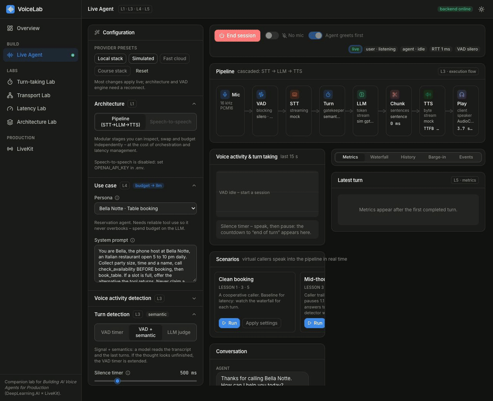
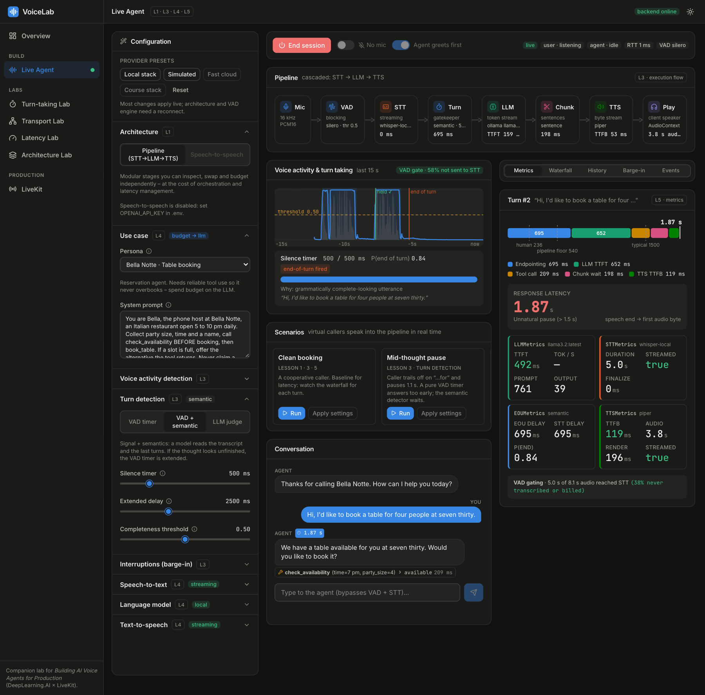
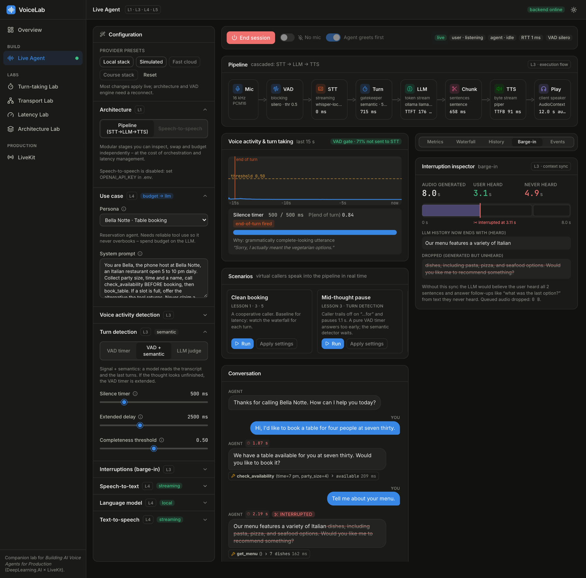
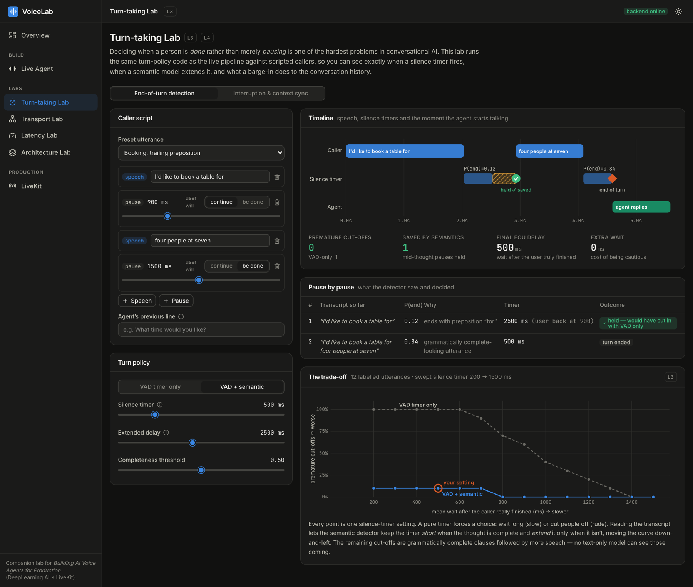
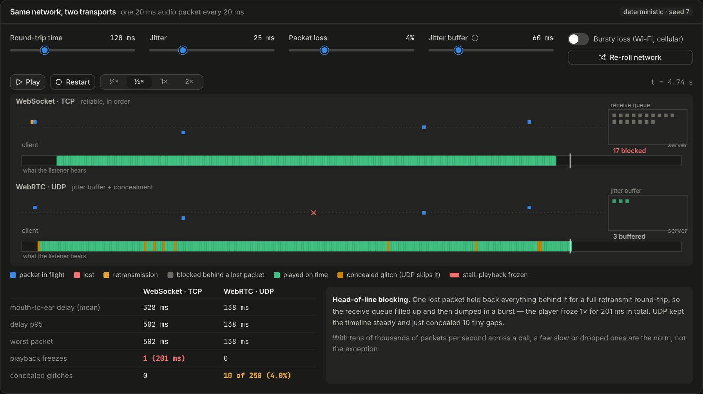
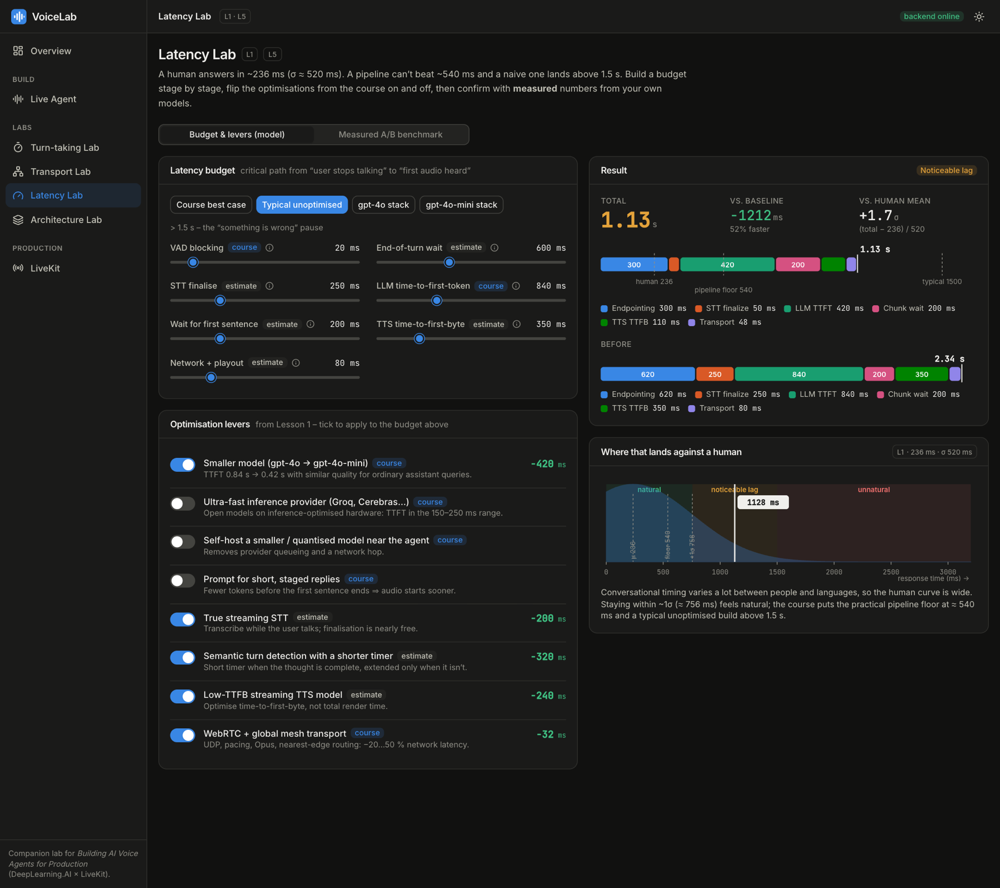
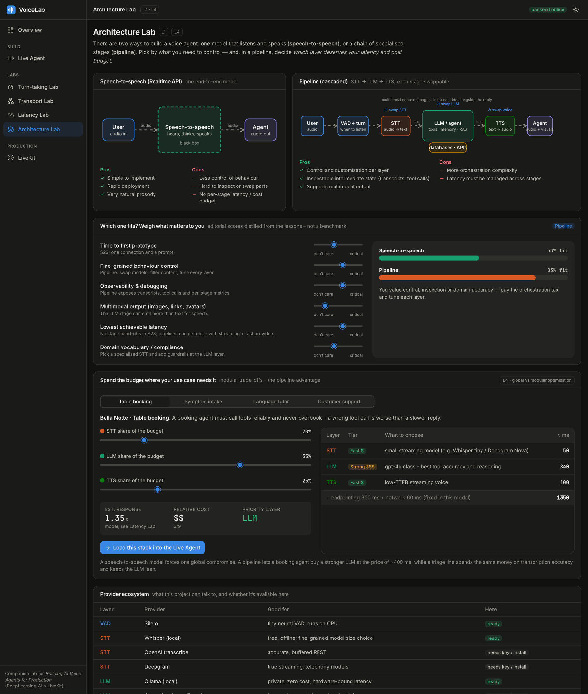
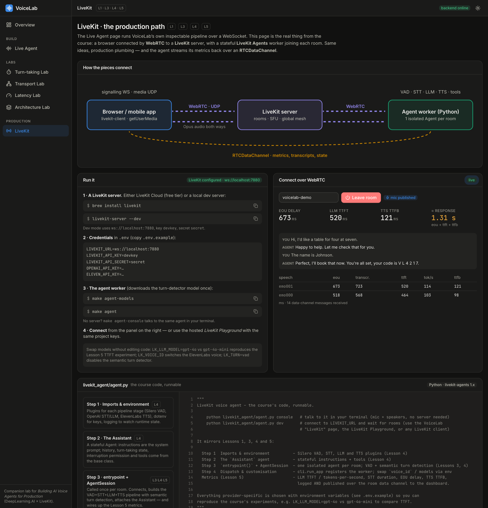
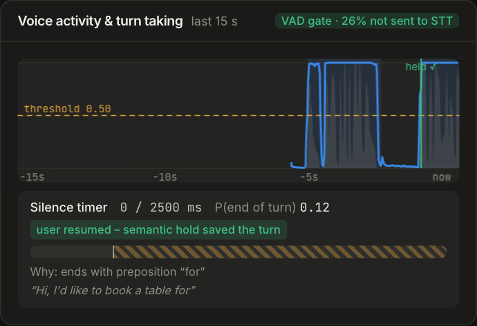
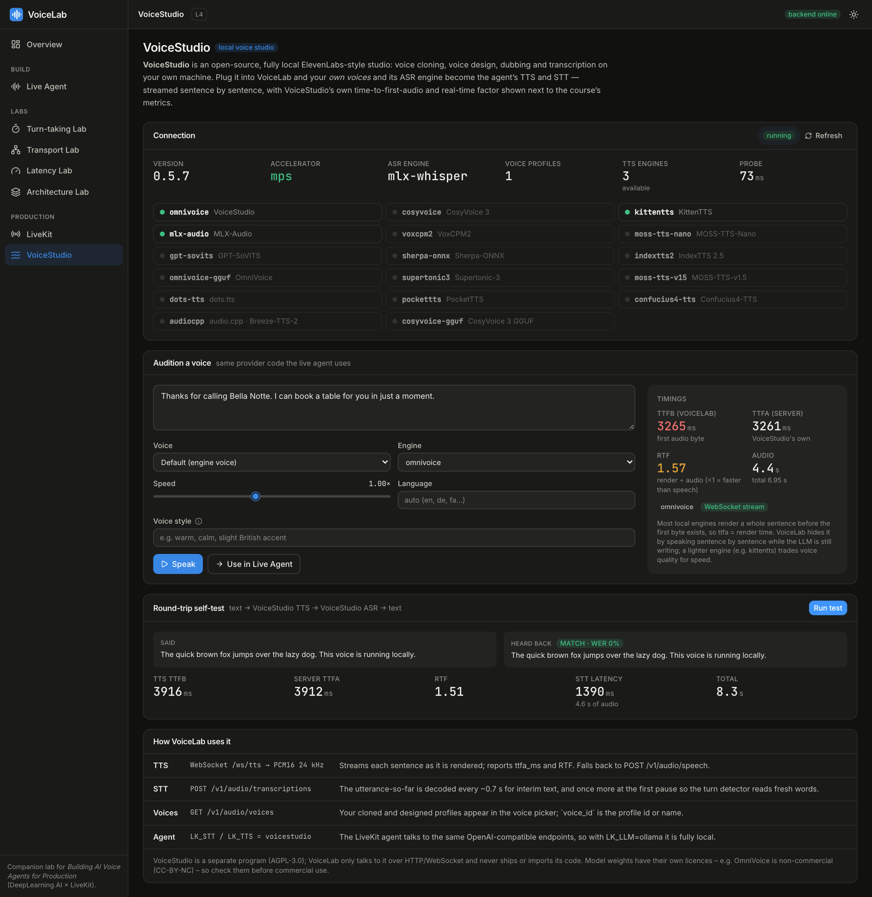

<div align="center">


# VoiceLab

**Build, break and measure production voice agents.**<br>
A streaming voice-agent pipeline you can talk to — with every millisecond, turn decision and interruption made visible.

<p>
  
  
  
  
  
  
  
  
</p>



<sub>A caller trails off at “…a table <i>for</i>”. A plain silence timer would cut in; the semantic detector extends it, the caller resumes, and the agent answers.<br>
(Silero VAD is real; STT, LLM and TTS are the simulated providers here, so the demo needs no models.)</sub>

</div>

---

Voice agents feel magical at half a second and broken at two. **VoiceLab** is a working agent *and* a set of labs that
show where those milliseconds go — and what you can do about them. It is a hands-on companion to the DeepLearning.AI × LiveKit
course *Building AI Voice Agents for Production*: every idea from the five lessons is something you can run, break and measure.

## Why it’s fun to work with

- 🎙️ **A real streaming pipeline, not a mock-up.** Silero VAD → faster-whisper → LLM (token streaming + tool calls) → sentence chunker → Piper TTS, all running on your laptop. Add cloud providers when you want them.
- ⏱️ **Latency you can *see*.** A live pipeline diagram, a streaming waterfall, and the exact metrics the course uses — TTFT, TTFB, end-of-utterance delay, tokens/s — for every turn.
- 🧠 **Turn-taking that reads the room.** A VAD silence timer *plus* a semantic check that extends the timer when a thought is unfinished (“…a table for”), with the trade-off curve to prove it helps.
- ✂️ **Barge-in done properly.** Interrupt the agent and it cancels the LLM and TTS, flushes playout, and trims its own history to **what you actually heard** — measured on the browser’s audio clock.
- 🧪 **Labs for what you can’t easily feel.** TCP head-of-line blocking vs WebRTC, a latency budget with the course’s optimisation levers, and a modular “spend the budget where your use case needs it” allocator.
- 🔌 **Swap anything.** Whisper / OpenAI / Deepgram, Ollama / OpenAI / Groq / Cerebras / Together / Anthropic, Piper / ElevenLabs / OpenAI — or OpenAI Realtime for speech-to-speech — all behind one event schema.
- 🗣️ **Your own voices, fully local.** Plug in [VoiceStudio](https://github.com/debpalash/VoiceStudio) and the agent speaks with voices you cloned or designed and listens with a local Whisper — streamed sentence by sentence, with the studio’s own time-to-first-audio and real-time factor on the metrics card. [Guide →](docs/VOICESTUDIO.md)
- 🛰️ **A path to production.** The course-style LiveKit agent is included, with metrics streamed back to the dashboard over an RTCDataChannel.

## Tour

<table>
<tr>
<td width="50%" valign="top"><a href="docs/screenshots/live-agent.png"></a><br><sub><b>Live Agent</b> — pipeline diagram, VAD trace, turn timer, latency breakdown and the four metric families, on a real local model stack.</sub></td>
<td width="50%" valign="top"><a href="docs/screenshots/barge-in.png"></a><br><sub><b>Barge-in inspector</b> — 8.0 s generated, 3.1 s heard: the LLM history stops where the listener did.</sub></td>
</tr>
<tr>
<td width="50%" valign="top"><a href="docs/screenshots/turn-lab.png"></a><br><sub><b>Turn-taking Lab</b> — when does the timer fire, when is it extended, and how many callers get cut off?</sub></td>
<td width="50%" valign="top"><a href="docs/screenshots/transport-lab.png"></a><br><sub><b>Transport Lab</b> — one lost packet stalls TCP’s receive queue; UDP just conceals it.</sub></td>
</tr>
<tr>
<td width="50%" valign="top"><a href="docs/screenshots/latency-lab.png"></a><br><sub><b>Latency Lab</b> — a budget model anchored to the course numbers, plus measured A/B benchmarks.</sub></td>
<td width="50%" valign="top"><a href="docs/screenshots/architecture-lab.png"></a><br><sub><b>Architecture Lab</b> — speech-to-speech vs pipeline, and where each use case should spend its budget.</sub></td>
</tr>
<tr>
<td width="50%" valign="top"><a href="docs/screenshots/livekit.png"></a><br><sub><b>LiveKit</b> — a real WebRTC join with metrics arriving over the data channel, next to the annotated agent code.</sub></td>
<td width="50%" valign="top"><a href="docs/screenshots/live-turn-detection.png"></a><br><sub><b>The semantic hold, on a real run</b> — “held ✓” marks the moment the caller resumed inside the extended timer.</sub></td>
</tr>
<tr>
<td colspan="2" valign="top"><a href="docs/screenshots/voicestudio.png"></a><br><sub><b>VoiceStudio</b> — a local voice studio as the agent’s TTS and STT: engines and voices, an audition with the server’s own TTFA / RTF, and a text → speech → text round-trip test (real run: OmniVoice + Whisper large-v3-turbo on Apple Silicon).</sub></td>
</tr>
</table>

## Quick start

Prerequisites: Python 3.11+ with [`uv`](https://docs.astral.sh/uv/), Node 20+, and — for the fully local stack — [Ollama](https://ollama.com) with a small chat model (`ollama pull llama3.2`).

```bash
git clone https://github.com/SinaaKh/deepL-voice-agents.git && cd deepL-voice-agents
make setup     # Python + Node deps, Whisper + Piper voices (~250 MB), creates .env
make start     # builds the dashboard and serves everything on http://localhost:8000
```

Hacking on the UI? `make dev` runs the backend with auto-reload plus the Vite dev server on <http://localhost:5173>. `make help` lists every task, `make test` runs the suite.

**No Ollama or models yet?** Pick the **Simulated** preset in the Live Agent — scripted replies with the course’s latency profiles, a synthetic voice, and an “oracle” STT for the built-in scenarios. Every lab works.
**With API keys**, copy them into `.env` (see [`.env.example`](.env.example)); providers show up in the dashboard automatically, and secrets never leave the backend.

### Bring your own voices (optional): VoiceStudio

```bash
make studio-install && make studio-up    # a local ElevenLabs-style studio on :3900 (about 2 GB of Python packages)
make studio-models                       # pick TTS / ASR models: they are large and carry licences, so nothing downloads silently
```

Then choose the **VoiceStudio** preset in the Live Agent or open the **VoiceStudio** page. Install notes, measured latency, licences and troubleshooting: [docs/VOICESTUDIO.md](docs/VOICESTUDIO.md).

## A 15-minute guided tour

1. **Baseline.** Live Agent → *Start session* → run **Clean booking**. Read the waterfall: STT runs *during* speech and TTS starts while the LLM is still streaming. Where do the milliseconds go?
2. **Turn detection.** Run **Mid-thought pause** with “VAD timer”, then “VAD + semantic”. Then open the Turn-taking Lab and drag the silence timer along the trade-off curve.
3. **Barge-in.** Run **Barge-in** and open the *Barge-in* tab: audio generated vs audio heard, and what the LLM’s history now ends with.
4. **Reproduce Lesson 5.** Latency Lab → *Measured*: gpt-4o vs gpt-4o-mini time-to-first-token (simulated profiles anchored to the course’s 0.84 s → 0.42 s, or real OpenAI with a key).
5. **Your own voice.** Start with the microphone on (**use headphones**, or the agent will hear itself) and talk over the agent.
6. **Break things.** Swap VAD for the naive energy gate, turn interruptions off, switch TTS to macOS `say` (a non-streaming TTS — watch its TTFB), enable guardrails and run **Sensitive data**.

<details>
<summary><b>How the course maps onto the project</b></summary>

| Lesson | Concept | Where to see it | Where it lives |
|---|---|---|---|
| 1 | Speech-to-speech vs pipeline | Architecture Lab; Live Agent → *Architecture* | `backend/voicelab/realtime`, `session.py` |
| 1 | VAD, end-of-turn detection | Live Agent VAD trace + timer; Turn-taking Lab | `vad/`, `turn/` |
| 1 | Human 236 ms (σ 520), floor 540 ms, typical > 1.5 s | Latency Lab, latency bars | `frontend/src/components/ui.tsx` (`HUMAN`) |
| 1 | Latency levers: smaller / quantised / fast-inference models, concise prompts | Latency Lab levers; Live Agent LLM + prompt | `llm/`, `personas.py` |
| 1 | Disfluencies, barge-in demo | Scenarios *Disfluent caller*, *Barge-in* | `scenarios.py` |
| 2 | TCP vs UDP, head-of-line blocking | Transport Lab lanes | `frontend/src/lib/transport.ts` |
| 2 | HTTP vs WebSocket vs WebRTC; Opus ≈ 3 %; pacing & timestamps | Transport Lab tables / payload / timelines | same |
| 2 | LiveKit mesh, −20…50 % network latency | Transport Lab mesh; LiveKit page | same, `livekit_agent/` |
| 3 | Stateful per-session agent; cascaded streaming flow; sentence chunking | Live Agent pipeline diagram | `session.py` (`SentenceChunker`, `_llm_producer`, `_tts_worker`) |
| 3 | VAD timer + semantic turn detector | Turn-taking Lab; Live Agent | `turn/`, `session._turn_timer` |
| 3 | Interruption: cancel LLM + TTS, flush; truncate history to what was heard | *Barge-in* tab; Turn-taking Lab → Interruption | `session._interrupt`, `interrupt.py`, `lib/audio.ts` (`playedMs`) |
| 4 | VAD gating (cost, STT hallucinations) | “VAD gate: N % not sent to STT” | `session._push_stt` |
| 4 | Modular trade-offs (booking → LLM, triage → STT); domain-tuned STT | Architecture Lab allocator; STT vocabulary hint | `personas.py` |
| 4 | Guardrails at the LLM layer; TTS `voice_id`, pronunciation overrides | Live Agent config; scenario *Sensitive data* | `session._begin_response`, `tts/` |
| 4 | Swapping the TTS / STT provider and `voice_id` for a local studio (your own cloned voices) | VoiceStudio page; Live Agent → *VoiceStudio* preset | `tts/`, `stt/`, `voicestudio.py`, `scripts/voicestudio.py` |
| 4 | LiveKit code: `Agent`, `AgentSession`, `entrypoint`, `cli.run_app` | LiveKit page code viewer | `livekit_agent/agent.py` |
| 5 | `getUserMedia`, `RTCDataChannel` (`getDisplayMedia` is not used here) | Mic capture; LiveKit metrics channel | `lib/audio.ts`, `LiveKitPage.tsx` |
| 5 | Blocking vs streaming stages | Waterfall + pipeline diagram labels | `session._emit_metrics` |
| 5 | TTFT, TTFB; `LLMMetrics / STTMetrics / EOUMetrics / TTSMetrics` | Metrics panel (same field names) | `session.py`, `livekit_agent/agent.py` |
| 5 | gpt-4o 0.84 s → gpt-4o-mini 0.42 s | Latency Lab → Measured | `benchmark.py`, `llm/mock.py` |

</details>

## Architecture

```
 mic ─► VAD ─► STT (streaming) ─► turn detection ─► LLM (token stream) ─► sentence chunker ─► TTS ─► speaker
          │            ▲  silence timer + semantic extension                                    │
          └── barge-in: cancel LLM + TTS, flush playout, truncate history to what was *heard* ◄─┘
```

```
frontend/ (React + TS + Tailwind)            backend/ (FastAPI, asyncio)
  Live Agent ──── WebSocket /ws/session ────►  VoiceSession  ─ VAD ─ STT ─ turn timer ─ LLM ─ chunker ─ TTS
   • mic → AudioWorklet → 16 kHz PCM16 ──►     │  emits JSON events (vad, stt.*, turn.*, llm.*, tts.*, interrupt…)
   • ◄── TTS PCM16 + JSON events               │  + ordered binary audio on the same queue (so a flush can drop it)
   • AudioContext player reports "played ms"   └─ RealtimeSession (OpenAI speech-to-speech bridge, same event schema)
  Turn / Latency / Transport / Architecture ─► REST: /api/turn/*, /api/benchmark, /api/providers …
  LiveKit page ── WebRTC ──► LiveKit server ◄── livekit_agent/agent.py (course code, per-room worker)
```

<details>
<summary><b>WebSocket protocol and providers</b></summary>

**`/ws/session`.** Client → server: JSON `start{config,greet}`, `config{config}` (live re-config), `text{text}`, `scenario{id}`, `playback{response_id,played_ms}`, `playout_done`, `flushed{played_ms}`, `ping`; binary = 16 kHz mono PCM16 microphone frames. Server → client: JSON events (every event carries `t`, ms on the session clock) and binary TTS PCM16, announced by `response.audio_start{sample_rate}`. A barge-in sends `flush`; the browser stops playout and answers `flushed{played_ms}` — that number is what the server uses to truncate the LLM history.

| Layer | Local (no key) | Cloud |
|---|---|---|
| VAD | Silero (ONNX), energy gate | – |
| STT | faster-whisper `tiny/base/small.en`, **VoiceStudio** ASR (MLX / Whisper engines) | OpenAI transcribe, Deepgram (streaming) |
| LLM | Ollama (OpenAI-compatible, tool calls) | OpenAI, Groq, Cerebras, Together (one OpenAI-compatible client), Anthropic |
| TTS | Piper (streaming neural), **VoiceStudio** (your cloned / designed voices; OmniVoice, KittenTTS …), macOS `say` (non-streaming baseline) | ElevenLabs, OpenAI |
| S2S | – | OpenAI Realtime |
| Mock | scripted STT/LLM with course latency profiles, synthetic voice | – |

</details>

## LiveKit mode — the production path

```bash
brew install livekit && make livekit-server     # local dev server: ws://localhost:7880, key devkey / secret secret
make agent-models                               # once: turn-detector weights
make agent                                      # the course agent (needs OPENAI_API_KEY + ELEVEN_API_KEY, or see knobs below)
```

Then open the **LiveKit** page and *Join room*. Without provider keys, `make demo-agent` publishes fake metrics into the room so you can watch the data-channel panel work; `make agent-console` talks to the agent in your terminal with no server at all. Knobs, no code edits: `LK_LLM_MODEL=gpt-4o` vs `gpt-4o-mini`, `LK_LLM=groq|cerebras|ollama`, `LK_STT=deepgram`, `LK_VOICE_ID=…`, `LK_TURN=vad`. Fully local, no keys: `LK_STT=voicestudio LK_TTS=voicestudio LK_LLM=ollama make agent` ([VoiceStudio guide](docs/VOICESTUDIO.md)).

## What’s verified — and what isn’t

| Area | Status |
|---|---|
| Pipeline on real local models (Silero, faster-whisper, Ollama `llama3.2` with tool calls, Piper, macOS `say`) | ✅ run end-to-end through the headless runner **and** the dashboard: turn detection, barge-in + history truncation, tool calls, metrics |
| Backend logic | ✅ 63 automated tests (`make test`): chunker, turn policy / simulator / sweep, truncation, VAD debounce, tools, guardrail, pipeline with mock providers, WebSocket protocol, realtime event mapping, Anthropic message mapping, the VoiceStudio client against a faithful fake of its API |
| Dashboard | ✅ type-checked, production-built, and exercised in real Chrome (every page) |
| Browser microphone path | ✅ `getUserMedia` → AudioWorklet → WebSocket verified in Chrome with a fake audio device (frames reached the server; Silero correctly rejected the test tone as non-speech). ⚠️ Not yet tried with a human voice in a browser — use headphones |
| LiveKit | ✅ WebRTC join to a local `livekit-server`, token endpoint, data-channel metrics (via `demo_publisher.py`); `agent.py` imports and builds its providers and `AgentSession` against `livekit-agents 1.8.11`. ⚠️ **Not run end-to-end** — that needs OpenAI / ElevenLabs keys |
| VoiceStudio v0.5.7 (local) | ✅ **run live** on an Apple M3 Pro with OmniVoice + Whisper large-v3-turbo: WebSocket TTS with server TTFA/RTF, barge-in socket discard, text→speech→text round trip (WER 0 %), a full agent turn, caller speech transcribed inside a session (`make studio-test`, 5 tests), and the LiveKit OpenAI-plugin path (TTS + STT calls, not a full room session). ⚠️ OmniVoice runs at RTF ≈ 1.3–1.65 here — slower than real time, ~4 s per sentence — so it suits auditioning voices more than snappy conversation. Windows / Linux and other engines (e.g. KittenTTS) are untested. Needs model downloads and licence acceptance ([guide](docs/VOICESTUDIO.md)) |
| OpenAI STT/TTS, ElevenLabs, Deepgram, Anthropic, OpenAI Realtime | ⚠️ written against the vendors’ docs, **not exercised against the live APIs** (no keys in the test environment). The OpenAI-compatible LLM path *is* verified — it is the same client used for Ollama |
| Transport Lab, latency & architecture budgets | ℹ️ models and simulations, labelled as such in the UI. Numbers from the course are tagged “course”; everything else is “estimate” |

## Project layout

```
backend/voicelab/   config · events · audio · session (the pipeline) · interrupt · scenarios · benchmark · voicestudio · main (API)
                    vad/ stt/ llm/ tts/ turn/ tools/ realtime/    – provider implementations
backend/tests/      pytest suite              backend/scripts/run_scenario.py   headless scenario runner
frontend/src/       pages/ (6 labs) · components/ (charts, pipeline diagram, config panel) · lib/ (session store, audio, simulators)
livekit_agent/      agent.py (course code)  ·  demo_publisher.py (keyless LiveKit demo)
scripts/            download_models.py · voicestudio.py (install/run/models/licences)    Makefile · .env.example · docs/ (VOICESTUDIO.md, images)
```

Headless smoke test of the real pipeline (prints every event): `cd backend && .venv/bin/python scripts/run_scenario.py barge_in --stt whisper-local --llm ollama --tts piper`

<details>
<summary><b>Troubleshooting</b></summary>

* **First session is slow** — Whisper and the Piper voice load (and Ollama loads its model) on first use; the status pill shows what is loading.
* **Agent keeps interrupting itself** — use headphones; the browser’s echo cancellation helps but isn’t perfect.
* **Long “STT finalize”** — use `tiny.en` (≈ 2× faster) or a streaming provider (Deepgram); Whisper re-transcribes the utterance so far.
* **The semantic turn detector is only as good as the transcript it reads.** In one of ~4 real runs Whisper heard “a table *for*” as “a table *saw*”, which looks like a finished sentence, so the caller was cut off. The STT **vocabulary hint** (pre-filled per persona) biases Whisper toward your domain and made the hold reliable in following runs, but it reduces the problem rather than removing it — a larger STT model or a streaming provider helps further.
* **Small local models misbehave** — e.g. `llama3.2` may send tool arguments as strings or print a tool call as text; the pipeline coerces the former and suppresses the latter instead of speaking JSON.
* **VoiceStudio** — “not running” → `make studio-up`; “licence not accepted” → `make studio-licences`; first call slow (engine/model load) → the session warm-up covers most of it. More in [docs/VOICESTUDIO.md](docs/VOICESTUDIO.md#troubleshooting).
* **Port in use** — backend `:8000`, Vite `:5173`, LiveKit `:7880`, VoiceStudio `:3900`.

</details>

---

<div align="center">
<sub>VoiceLab is an independent project built as a companion to the DeepLearning.AI × LiveKit course <i>Building AI Voice Agents for Production</i>.<br>
It is not affiliated with or endorsed by DeepLearning.AI or LiveKit; names and trademarks belong to their owners.</sub>
</div>
